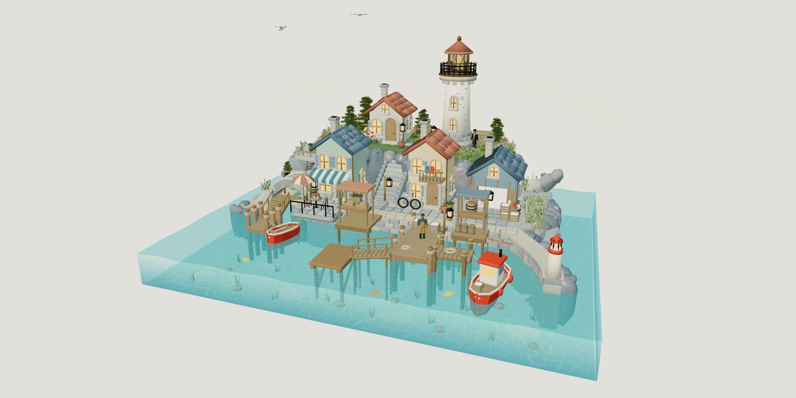
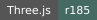
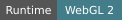
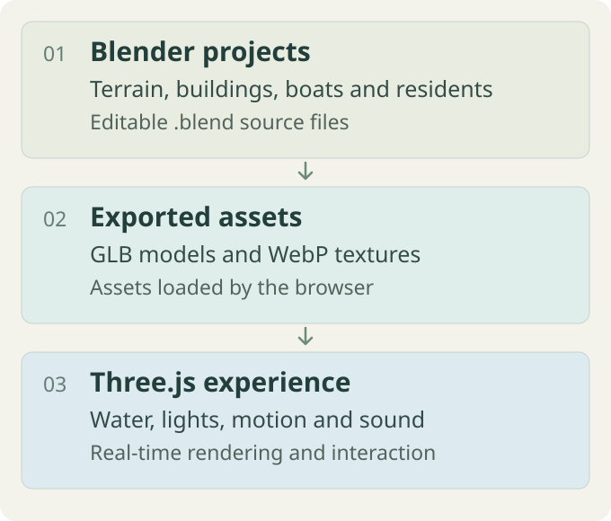

<div align="center">

# Blender Exploration · Twilight Harbor

[简体中文](README.md) · **[English](README.en.md)**



**Walk around the island, send ripples across the water, and listen to the sea.**

[Quick start](#quick-start) · [First look](#first-look) · [How it works](#how-it-works) · [Model projects (Chinese)](docs/architecture.md) · [Asset sources](THIRD_PARTY_NOTICES.md)

[](package.json)
[](docs/architecture.md)
[](THIRD_PARTY_NOTICES.md)
[](#quick-start)
[](LICENSE)

</div>

> [!NOTE]
> This is the **v3.42 local interactive prototype**: a Blender scene and characters combined with real-time Three.js water, lighting, and interactions. The repository includes runnable code and selected editable models. There is no public website deployment or published Xiaohongshu mini app. The interface is in Chinese.

## What problem does it solve?

The project turns a harbor modeled in Blender into a small world you can approach, touch, and listen to in a browser. It explores how 3D models can become lightweight interactive experiences while retaining source models for continued development.

## First look

After starting the local scene, use this short path to confirm the main experience:

1. In “看全景”, drag to orbit and zoom, confirming the lighthouse, houses, pier, and transparent water load.
2. Choose “到码头” and click the water to see ripples, underwater fish, and floating-object feedback.
3. Click a character to see the greeting or fishing-rod action; switch day and night to check the lighting and ambient color change together.
4. Click the bottom play button, then use the sound and rest panels to mix waves, wind, seagulls, and shop ambience.

## How it works



Blender files keep editable inputs for terrain, buildings, piers, boats, and characters. The browser loads exported GLB and WebP assets, then the Three.js runtime adds dynamic water, day/night lighting, animal paths, character actions, and sound. This keeps the web experience runnable while leaving the source projects available for further work. See [model and runtime responsibilities](docs/architecture.md) (Chinese) for the file map.


## Quick start

Viewing the web scene requires **Python 3.10+** and a modern browser with WebGL 2. Blender, Node.js, and npm dependencies are not needed for this.

```sh
git clone https://github.com/ZhangShixing0/blender-exploration.git
cd blender-exploration
python scripts/serve.py
```

Open **[http://127.0.0.1:8765/](http://127.0.0.1:8765/)**. On Windows you can also use `py`; macOS / Linux commonly use `python3`.

If another preview occupies the port, run `python scripts/serve.py --port 8766` and open that port instead. Do not open the HTML file directly: models and modules must load over HTTP.

The first visit loads about 30 MB of scene, character, and shared texture assets; loading time depends on the device. Sound starts off. Click the play button at the bottom to load and play audio. Sound preferences stay in the local browser and are not uploaded.

## What you can do

- **Explore the harbor**: drag to orbit, zoom from a wide view into the lighthouse, café, and pier, and switch between day and night.
- **Touch the water**: click to create ripples and watch fish, seagulls, and boats.
- **Visit the residents**: meet the lighthouse keeper, fisher, and traveler, each using a selected character model. Click to greet them; the fisher can pick up a fishing rod.
- **Stay a while**: mix waves, wind, seagulls, and shop ambience, save combinations, and set a rest timer.
- **Capture a moment**: try the lighthouse boat-arrival and light-rain interactions, or export a postcard of the current view.

## Current version

| Component | Status |
| --- | --- |
| Main web scene | v3.42, including natural lighting, day/night, water, and interactions |
| Characters | v3.40 web variants, with leg-proportion adjustments, rigged waving, and texture-loading changes |
| Geometry contacts | v3.41 bench and fence fixes; v3.42 connections between two canopy roofs and eight wooden posts |
| Blender source files | Five projects: the base harbor, pilot boat, and three characters |

**Web material adjustments, dynamic water, animal paths, and bench/canopy repairs run in JavaScript.** Opening the harbor `.blend` shows the base scene without every web effect. See [model and runtime responsibilities](docs/architecture.md) (Chinese).

## Verify the project

With Node.js installed, run the following; `npm install` is not required:

```sh
python scripts/verify_bundle.py
```

This checks model and texture hashes, external GLB dependencies, JavaScript syntax, and module references. `package.json` declares only the version and convenience commands; the Three.js runtime is bundled. The release checks were run locally, with no GitHub Actions configured. The publication copy was also checked for real-browser loading and day/night switching; see [release verification](docs/verification.md) (Chinese). These checks do not prove that every island viewpoint is free of geometry intersections or that mobile performance has been accepted.

<details>
<summary>Directories and editing entry points</summary>

```text
web/暮色海港3d/       Current web scene, runtime models, sound, and Three.js
scenes/              Base harbor and pilot-boat Blender projects
experiments/         Selected Blender projects for the three residents
scripts/             Local preview, bundle checks, and selected model exporters
docs/                Architecture, verification, sources, and an actual web preview
licenses/            Original third-party license texts
asset-manifest.json  Published asset sizes and SHA-256 hashes
```

Historical animations, frame-by-frame renders, old models, browser caches, and feedback screenshots from the original workspace are not included. Images are packed into all five Blender projects. See the [project guide](docs/architecture.md) (Chinese) for editing and export order.

</details>

## Data and security

The preview server listens locally only and has no login, upload, or database endpoints. Sound combinations are stored in browser localStorage; postcards are saved to your device. The repository excludes login state, keys, unrelated project materials, and historical screenshot caches. Public deployment requires separately configured production static hosting.

## License

The repository is public, but its original code, scene composition, and custom clothing have not been granted an open-source license; see [LICENSE](LICENSE). Third-party assets retain their own licenses. Sources and notices for Three.js, Draco, Quaternius base characters, Poly Haven materials, and Freesound ambience are in [THIRD_PARTY_NOTICES.md](THIRD_PARTY_NOTICES.md). Public visibility does not grant an MIT or other open-source license.
