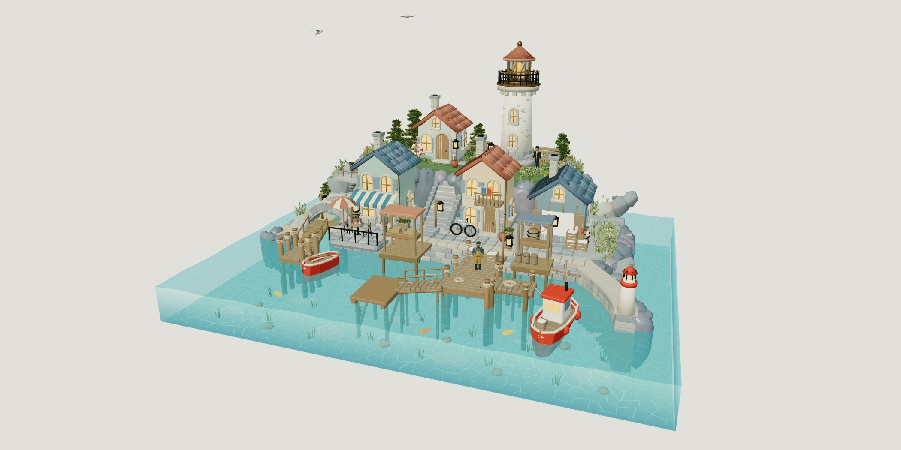
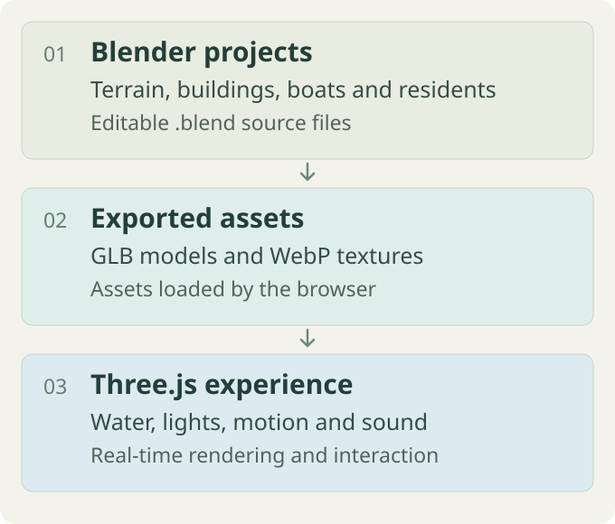

<div align="center">

# Blender Exploration · Twilight Harbor

[简体中文](README.md) · **[English](README.en.md)**



**Turn a Blender harbor into a browser-based 3D prototype you can approach, touch, and listen to.**

[Problem](#what-problem-does-it-solve) · [First look](#first-look) · [How it works](#how-it-works) · [Quick start](#quick-start) · [Verification](#verify-the-project)

[](package.json)
[](docs/architecture.md)
[](THIRD_PARTY_NOTICES.md)
[](#quick-start)
[](LICENSE)

</div>

> [!NOTE]
> This is the **v3.42 local interactive prototype**. The repository keeps the runnable web scene, selected editable Blender projects, and release verification notes. It has no public deployment URL and is not a published Xiaohongshu mini app. The interface is in Chinese.

## What problem does it solve?

This project explores a clear production path: build the harbor and characters in Blender, export browser-ready assets, then use Three.js to add water, lighting, sound, and interactions. You can try the web scene directly or follow the project guide to continue editing the models.

## First look

After starting the local scene, use this short path to confirm the main experience:

1. Drag to orbit and zoom, confirming that the lighthouse, houses, pier, and transparent water load.
2. Click the water to see ripples, underwater fish, and floating-object feedback.
3. Click a character to see the greeting or fishing-rod action; switch day and night to check the lighting and ambient color change together.
4. Click the bottom play button, then mix waves, wind, seagulls, and shop ambience.

## Interactions

- **Explore the harbor**: orbit and zoom between the lighthouse, café, and pier, then switch between day and night.
- **Touch the water**: click to create ripples and watch fish, seagulls, and boats move.
- **Visit the residents**: inspect the lighthouse keeper, fisher, and traveler models; trigger waving and fishing-rod actions.
- **Mix ambient sound**: combine waves, wind, seagulls, and shop ambience, save a mix, and set a rest timer.
- **Capture the view**: try the boat-arrival and light-rain interactions, then export the current view as a postcard.

## How it works



Blender files keep editable inputs for terrain, buildings, piers, boats, and characters. The browser loads exported GLB and WebP assets, then the Three.js runtime adds dynamic water, day/night lighting, animal paths, character actions, and sound. See [model and runtime responsibilities](docs/architecture.md) (Chinese) for the file map.

**Web material adjustments, dynamic water, animal paths, and bench/canopy repairs run in JavaScript.** Opening the harbor `.blend` shows the base scene without every web effect.

## Quick start

To view the web scene, you need **Python 3.10+** and a modern browser with WebGL 2. Blender, Node.js, and npm dependencies are not required:

```sh
git clone https://github.com/ZhangShixing0/blender-exploration.git
cd blender-exploration
python scripts/serve.py
```

Open **[http://127.0.0.1:8765/](http://127.0.0.1:8765/)**. On Windows you can also use py; macOS and Linux commonly use python3. If the port is busy, run python scripts/serve.py --port 8766.

Do not open the HTML file directly: models and ES modules must load over HTTP. The first visit loads about 30 MB of scene, character, and shared texture assets. Sound starts off and is loaded after you click the play button.

## Verify the project

| Scope | Current state |
| --- | --- |
| Main web scene | v3.42; natural lighting, day/night, water, and interactions remain in the release snapshot |
| Characters | v3.40 web variants with proportion, rigged waving, and texture-loading adjustments |
| Geometry repairs | v3.41 bench/fence fixes; v3.42 connections between two canopy roofs and eight wooden posts |
| Blender projects | Five projects: the base harbor, pilot boat, and three residents |
| Public status | Local prototype; no public deployment or Xiaohongshu mini app |

With Node.js installed, check the published assets and references; `npm install` is not required:

```sh
python scripts/verify_bundle.py
```

The check covers model and texture hashes, external GLB dependencies, JavaScript syntax, and module references. Three.js is bundled; `package.json` declares the version and convenience commands. Existing verification ran locally, with no GitHub Actions configured. Browser loading, day/night switching, audio reads, and narrow-screen checks are recorded in [release verification](docs/verification.md) (Chinese). These checks do not prove that every island viewpoint is free of intersections or that mobile performance has been accepted.

## Project entry points

<details>
<summary>Choose an entry point by the change you want to make</summary>

| Change | Start here |
| --- | --- |
| Harbor, houses, pier, and water geometry | Base .blend projects in scenes/ |
| Lighthouse keeper, fisher, and traveler | The three character projects in experiments/ |
| Water, day/night, camera, and color | Runtime modules in web/暮色海港3d/ |
| Re-exporting models | Export scripts in scripts/; see the [project guide](docs/architecture.md) |
| Dependency sources and licenses | [Third-party notices](THIRD_PARTY_NOTICES.md) and licenses/ |

Historical animations, frame-by-frame renders, old models, browser caches, and feedback screenshots are not included. Images are packed into all five Blender projects; asset sizes and SHA-256 hashes are recorded in `asset-manifest.json`.

</details>

## Data and security

The preview server listens locally only and has no login, upload, or database endpoints. Sound mixes are stored in browser localStorage; postcards are saved to your device. The repository excludes login state, keys, unrelated project materials, and historical screenshot caches. Public deployment requires separately configured static hosting.

## License

The repository is public, but its original code, scene composition, and custom clothing have not been granted an open-source license; see [LICENSE](LICENSE). Third-party content such as Three.js, Draco, Quaternius, Poly Haven, and Freesound remains under its own licenses; sources and notices are in [THIRD_PARTY_NOTICES.md](THIRD_PARTY_NOTICES.md).
