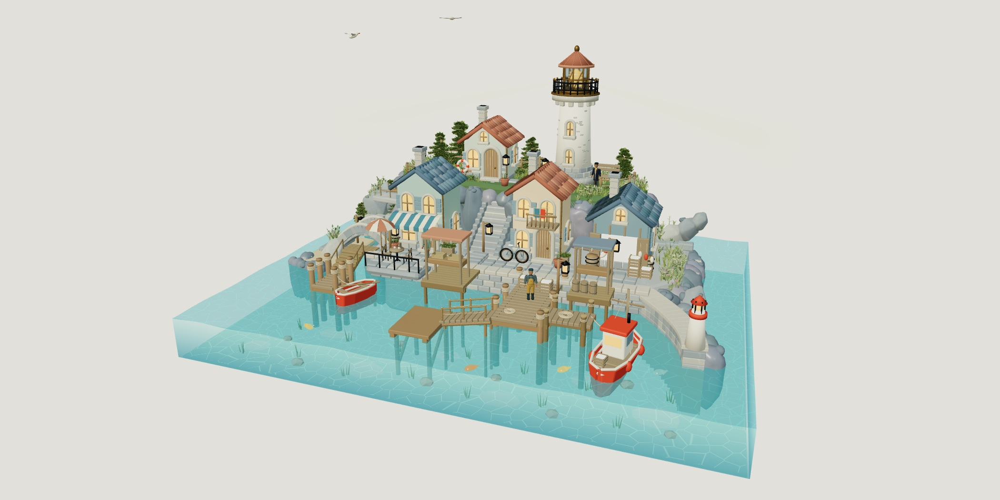
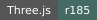
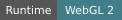
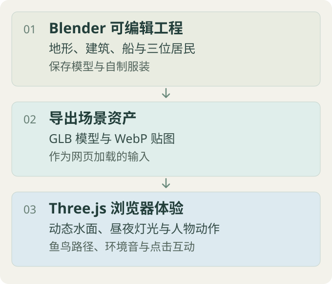

<div align="center">

# Blender探索·暮色海港

**[简体中文](README.md)** · [English](README.en.md)



**把 Blender 海港变成可以靠近、触碰与聆听的浏览器三维原型。**

[项目解决什么问题](#项目解决什么问题) · [先看效果](#先看效果) · [工作方式](#工作方式) · [快速开始](#快速开始) · [核验记录](#当前版本与验证)

[](package.json)
[](docs/architecture.md)
[](THIRD_PARTY_NOTICES.md)
[](#快速开始)
[](LICENSE)

</div>

> [!NOTE]
> 当前是 **v3.42 本地交互原型**。仓库保留可运行网页、选定的 Blender 可编辑工程和发布核验记录；它还没有公共部署地址，也不是已上架的小红书小程序。

## 项目解决什么问题

这个项目探索一条清晰的制作链：在 Blender 中制作海港与人物，把模型导出为浏览器资源，再用 Three.js 加上水面、灯光、声音和互动。读者可以直接体验网页，也可以沿着工程说明继续编辑模型。

## 先看效果

启动本地网页后，可以按这个顺序确认主要体验：

1. 拖动旋转、缩放，确认灯塔、房屋、码头和透明水体已经加载。
2. 点击水面，看到涟漪、水下鱼群和漂浮物的互动反馈。
3. 点击人物查看招手或钓竿动作；切换白天与夜晚，确认灯光和环境色一起变化。
4. 点击底部播放按钮，再组合海浪、海风、海鸥和小店环境音。

## 体验能力

- **探索海港**：拖动旋转、缩放视角，在灯塔、咖啡馆和码头之间切换昼夜。
- **触碰水面**：点击形成涟漪，观察游鱼、海鸥和小船的动态。
- **拜访居民**：查看守塔人、渔夫和旅人的角色模型，点击触发招手与钓竿动作。
- **组合环境音**：混合海浪、海风、海鸥和小店声音，保存组合并设置小憩计时。
- **记录当前画面**：体验灯塔接船和小雨互动，并把当前视角导出为明信片。

## 工作方式



Blender 文件保存地形、建筑、码头、船和人物等可编辑输入；浏览器加载导出的 GLB 与 WebP，再由 Three.js 运行时补上动态水面、昼夜灯光、动物路径、人物动作和声音。详细的文件分工见[模型与运行时的分工](docs/architecture.md)。

**网页中的材质调整、动态水面、动物路径、长椅与棚顶修补由 JavaScript 执行。** 打开海港 `.blend` 看到的是基础场景，不包含所有网页效果。

## 快速开始

只体验网页需要 **Python 3.10+** 和支持 WebGL 2 的现代浏览器，不需要安装 Blender、Node.js 或 npm 依赖：

```sh
git clone https://github.com/ZhangShixing0/blender-exploration.git
cd blender-exploration
python scripts/serve.py
```

打开 **[http://127.0.0.1:8765/](http://127.0.0.1:8765/)**。Windows 也可使用 py，macOS / Linux 通常使用 python3。端口被占用时运行 python scripts/serve.py --port 8766。

不要直接双击 HTML；模型和 ES 模块需要通过 HTTP 加载。第一次打开会加载约 30 MB 的场景、人物和共享贴图，声音默认关闭，点击底部播放按钮后才会读取并播放。

## 当前版本与验证

| 范围 | 当前状态 |
| --- | --- |
| 主网页 | v3.42；自然光、昼夜、水体和互动保留在发布快照 |
| 人物 | v3.40 网页衍生版；包含比例、骨骼招手和贴图加载调整 |
| 几何修补 | v3.41 长椅与围栏；v3.42 两座棚顶与八根木柱的连接 |
| Blender 工程 | 海港基础、引航船和三位居民，共五份 |
| 公开状态 | 本地原型；没有公共部署或小红书小程序 |

安装 Node.js 后检查发布资产和引用；不需要 `npm install`：

```sh
python scripts/verify_bundle.py
```

这项检查覆盖模型与贴图哈希、GLB 外部依赖、JavaScript 语法和模块引用。Three.js 运行时已随项目提供；`package.json` 仅声明版本和便捷命令。已有核验在本地完成，未配置 GitHub Actions。浏览器加载、昼夜切换、音频读取与窄屏核验见[发布核验](docs/verification.md)。这些检查不等同于全岛所有角度的穿模审查或真实手机性能验收。

## 工程入口

<details>
<summary>按修改目标选择入口</summary>

| 想修改什么 | 先看哪里 |
| --- | --- |
| 海港、房屋、码头和水体几何 | scenes/ 中的基础 .blend 工程 |
| 守塔人、渔夫和旅人 | experiments/ 中的三份角色工程 |
| 水面、昼夜、相机与色彩 | web/暮色海港3d/ 的运行时模块 |
| 重新导出模型 | scripts/ 中的导出脚本；顺序见[工程说明](docs/architecture.md) |
| 依赖来源与许可 | [第三方来源](THIRD_PARTY_NOTICES.md) 与 licenses/ |

历史动画、逐帧渲染、旧模型、浏览器缓存和反馈截图未包含在仓库中。五份 Blender 工程的图像已打包；资产尺寸和 SHA-256 记录在 `asset-manifest.json`。

</details>

## 数据与安全

预览服务只监听本机，不提供登录、上传或数据库接口。声音组合保存在浏览器 localStorage，明信片保存到自己的设备。仓库不包含登录状态、密钥、其他项目资料或历史截图缓存；正式公共部署需要另行配置静态托管。

## 许可

本仓库公开可见，但原创代码、场景编排和自制服装暂未授予开源许可，详见 [LICENSE](LICENSE)。Three.js、Draco、Quaternius、Poly Haven 和 Freesound 等第三方内容继续遵循各自许可，出处与说明见 [THIRD_PARTY_NOTICES.md](THIRD_PARTY_NOTICES.md)。
